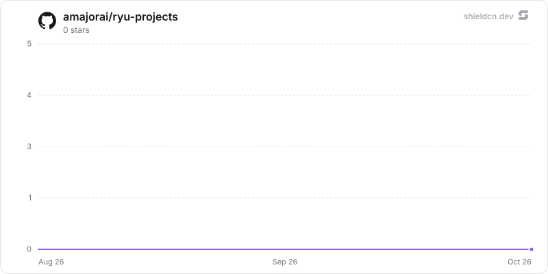

<div align="center">

# projects

</div>

A durable coordinator workspace for projects, shared context, delegated workers, and recurring signals.

> **The public home of `ryu-projects`.** Source, builds, and releases live here —
> binaries for every platform are attached to each release.
>
> This tree is generated from the Ryu monorepo, so commits pushed here
> directly are replaced on the next sync. **Pull requests are welcome** —
> open them here and they are ported into the monorepo, then flow back out.
> Ryu as a whole: https://github.com/amajorai/ryu

## Install

**App:** [Install](ryu://apps/com.ryu.projects) (opens the Ryu desktop app and asks you to confirm)

**CLI:**

```bash
ryu apps add com.ryu.projects
```

## Source & build

This satellite carries the Rust coordinator backend plus the Companion UI.
The backend builds with Cargo; the UI imports Ryu's private `@ryu/ui`
design system and is shipped as the prebuilt `dist/index.html` bundle.

## License

Apache-2.0 — see [LICENSE](./LICENSE).

## Build and test

```sh
bun run --cwd apps-store/projects/ui test
bun run --cwd apps-store/projects/ui check-types
bun run --cwd apps-store/projects/ui build

# Sidecar checks
RYU_PROFILE=dev RYU_KEYCHAIN=off RYU_DIR=/tmp/ryu-projects-headless cargo test -p ryu-projects
```

## At rest

`projects.db` seals every record body per value (`encb:v1:`, store `projects.db`, bound to the
table and the row id) under the `@ryu/projects` plugin subkey Core delivers to the sidecar
(`crypto:seal` in the sidecar's `host_api.grants`): `projects.body` (name, client, owner,
description, instructions, working folder), `context.body` (decisions and notes),
`workers.body` and `subscriptions.body`. Writes seal through the `ryu_seal` SQL function and
reads open through `ryu_open` (`src/seal_sql.rs`). Tenant and project ids, the subscription
`enabled`/`next_run_at` schedule columns and timestamps stay plaintext: the tenant filter and
the due-schedule claim run on them. Shared imports from another node are sealed on write like
local saves. Legacy plaintext rows are sealed when the store opens (resumable, idempotent), then
the WAL is truncated and freed pages are zeroed (`secure_delete` is on for every connection). A
record that does not open is left out of lists and counted (`/health`
`sealing.unreadable_rows`).
Key states (`backend/src/seal_keys.rs`):

- **Compat mode**: under an older Core that delivers no key, a never-sealed store keeps working
  in plaintext and `/health` reports `sealing.state = "compat"` ("waiting for a Ryu update").
- **No key or another key for a sealed store**: `sealing.state = "unhealthy"`, writes are
  refused and the data is kept.
- **Standalone** (no `RYU_PLUGIN_DATA_DIR`): `RYU_MASTER_KEY` if set, else a generated root in
  `<plugin data dir>/secrets/standalone-root.key` (0600) whose key check value is pinned.

The standalone satellite mirror builds `ryu-crypto` from crates.io at the declared version, so
the release train that ships this must publish `ryu-crypto` first (already ordered before app
backends in `tools/publish-crates.sh`).

## Star History

<a href="https://github.com/amajorai/ryu-projects/stargazers">
  <picture>
    <source media="(prefers-color-scheme: dark)" srcset="./.github/shieldcn/star-chart-dark.svg" />
    
  </picture>
</a>
